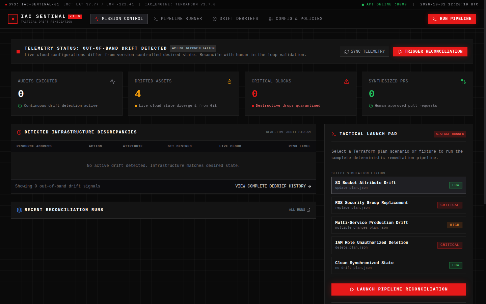
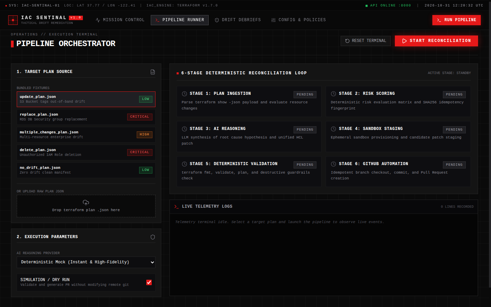

# 🛡️ IaC Sentinal — AI-Assisted Terraform Infrastructure Drift Detection & Human-Approved Remediation

[](https://www.python.org/downloads/)
[](https://nextjs.org/)
[](https://fastapi.tiangolo.com/)
[](https://www.terraform.io/)
[](LICENSE)

> *"When Reality Drifts from the Plan, Pull It Back into Line."*

**IaC Sentinal** is an enterprise-grade, human-in-the-loop DevOps automation platform. It continuously detects when live AWS cloud infrastructure drifts out-of-band away from the Terraform manifests describing it, diagnoses root causes using LLM reasoning (Gemini / OpenAI / Mock), synthesizes minimal corrective HCL patches, deterministically validates changes in ephemeral sandboxes, and opens reviewable GitHub Pull Requests with idempotency guarantees.

Now upgraded with a real-time **Tactical Telemetry Mission Control Web UI** and **FastAPI backend**.

🔗 **Live Deployment:** [https://iac-sentinal.vercel.app](https://iac-sentinal.vercel.app)

---

## 📸 Mission Control Interface

| 🖥️ Tactical Mission Control Dashboard |
| :---: |
|  |

| ⚡ 6-Stage Deterministic Pipeline Orchestrator |
| :---: |
|  |

---

## 🔑 Core Design Principle

$$\text{The LLM Proposes} \longrightarrow \text{Terraform Validates} \longrightarrow \text{GitHub Reviews} \longrightarrow \text{A Human Approves}$$

> ⚠️ **IaC Sentinal never silently modifies production infrastructure.** Every remediation requires deterministic syntax validation, destructive drop guardrails, and explicit human engineer approval before merge.

---

## 🏛️ High-Level System Architecture

```
+-----------------------------------------------------------------------------------------+
|                        1. FRONTEND: MISSION CONTROL WEB UI                              |
|                        Next.js 14 (App Router) + Tailwind CSS                           |
|      http://localhost:3000 — Tactical Telemetry Dashboard, Live WS Terminal & Diffs     |
+-----------------------------------------------------------------------------------------+
                                           ▲
                                           │ REST API + Real-Time WebSockets
                                           ▼
+-----------------------------------------------------------------------------------------+
|                        2. API LAYER: ASYNC BACKEND SERVICE                              |
|                        FastAPI + Uvicorn + WebSockets                                   |
|      http://localhost:8000 — Orchestration, Telemetry Streamer & Audit Store           |
+-----------------------------------------------------------------------------------------+
                                           ▲
                                           │ Direct Python Engine Invocations
                                           ▼
+-----------------------------------------------------------------------------------------+
|                        3. CORE ENGINE: DETERMINISTIC RECONCILIATION                     |
|                                                                                         |
|  [Stage 1] PlanParser          --> Normalized Terraform JSON Plan                       |
|  [Stage 2] DriftDetector       --> Risk Matrix Classification & SHA256 Fingerprint      |
|  [Stage 3] LLMAnalyzer         --> AI Diagnosis & Unified HCL Patch (Gemini/OpenAI)     |
|  [Stage 4] PatchGenerator      --> Ephemeral Sandbox Staging Workspace                  |
|  [Stage 5] TerraformValidator  --> Deterministic fmt, validate & Zero-Destroy Checks   |
|  [Stage 6] GitHubManager       --> Idempotent PR Automation & Duplicate Suppression     |
+-----------------------------------------------------------------------------------------+
                                           ▲
                                           │
                     +---------------------+---------------------+
                     |                                           |
                     ▼                                           ▼
          +----------------------+                    +----------------------+
          |   Terraform Engine   |                    |    GitHub REST API   |
          |  fmt · val · plan    |                    |  Branch · Commit· PR |
          +----------------------+                    +----------------------+
```

---

## 🚀 Key Features

* **Real-time Mission Control UI**:
  * **System Parity Beacon**: Glowing status beacon indicating whether live assets are in sync or actively drifting.
  * **Bento KPI Matrix**: Real-time readouts for *Audits Executed*, *Drifted Assets*, *Critical Blocks*, and *Synthesized PRs*.
  * **Live Discrepancies Table**: Compares Live AWS Cloud vs Git Desired state with line-by-line attribute diffs.
  * **1-Click Launch Pad**: Instant simulation runner with bundled test fixtures.
  * **Interactive Diff Viewer**: Syntax-highlighted HCL candidate patch (green additions, red deletions).
* **Deterministic Risk Engine**:
  * Automatically categorizes drift into `LOW`, `MEDIUM`, `HIGH`, or `CRITICAL`.
  * **Strict Destructive Guardrails**: Deletions and stateful replacements are blocked from automated merge and escalated to human engineers.
* **Ephemeral Workspace Sandboxing**:
  * Patches are staged and tested inside temporary isolated workspaces (`/tmp/...`) with path-traversal security controls.
* **Duplicate PR Suppression (Idempotency)**:
  * Computes a deterministic SHA256 fingerprint across all drifted resources. If an open PR already exists for the same drift signature, duplicate PR creation is suppressed.
* **Multi-Provider AI Layer**:
  * Supports Google Gemini 2.5 Flash, OpenAI GPT-4o, and an offline Deterministic Mock mode. The LLM never receives AWS credentials.
* **Audit Trail & Observability**:
  * Full JSONL audit logging (`logs/meridian_audit.jsonl`) for compliance, tracking every plan ingested and decision made.

---

## 📁 Repository Structure

```
IaC-Sentinal/
├── frontend/                 # Next.js 14 Web Application
│   ├── app/                  # App Router pages (Dashboard, Pipeline, Reports, Settings)
│   ├── components/           # UI components, badges, navbars & status dots
│   ├── lib/                  # TypeScript API client & data models
│   └── globals.css           # Tactical Dark design tokens & animations
├── api/                      # FastAPI Backend Layer
│   ├── main.py               # FastAPI entrypoint, CORS & WebSocket handlers
│   ├── store.py              # In-memory telemetry & run history store
│   ├── websocket.py          # WebSocket connection manager
│   ├── schemas.py            # API request/response Pydantic models
│   └── routes/               # Modular endpoints (pipeline, drift, reports, config, upload)
├── src/                      # Core Deterministic Python Engine
│   ├── main.py               # CLI orchestrator & entrypoint
│   ├── config.py             # Global settings, risk matrix & environment config
│   ├── plan_parser.py        # Terraform plan JSON parser
│   ├── drift_detector.py     # Deterministic drift classifier & fingerprinting
│   ├── drift_model.py        # Core Pydantic data schemas
│   ├── llm_analyzer.py       # Multi-provider AI reasoning & patch synthesizer
│   ├── patch_generator.py    # Sandboxed workspace manager
│   ├── validator.py          # Deterministic syntax & zero-destroy validator
│   ├── github_manager.py     # GitHub PR automator & duplicate suppression
│   ├── audit_logger.py       # Structured JSONL audit logger
│   └── exceptions.py         # Custom domain exceptions
├── figma/                    # Complete UX Wireframing Suite & Design Specs
│   ├── 00_design_system_and_tokens.svg
│   ├── 01_dashboard_wireframe.svg
│   ├── 02_pipeline_orchestrator_wireframe.svg
│   ├── 03_debriefs_archive_wireframe.svg
│   ├── 04_detailed_debrief_diff_viewer.svg
│   ├── 05_settings_governance_wireframe.svg
│   ├── figma_canvas_generator.js
│   └── WIREFRAME_DESIGN_SPEC.md
├── terraform/                # Reference Terraform infrastructure
│   ├── main.tf
│   ├── variables.tf
│   ├── outputs.tf
│   └── versions.tf
├── tests/                    # Unit & End-to-End Test Suites (25 passing tests)
│   ├── fixtures/             # Realistic plan JSON test fixtures
│   ├── test_drift_detector.py
│   ├── test_e2e_pipeline.py
│   ├── test_llm_analyzer.py
│   ├── test_patch_generator.py
│   ├── test_plan_parser.py
│   └── test_validation.py
├── docs/                     # Architecture, Walkthroughs & Codebase Guides
│   ├── CODEBASE_EXPLAINED.md
│   ├── FRONTEND_UI_WALKTHROUGH.md
│   ├── PROJECT_ARCHITECTURE_AND_WORKFLOW.md
│   └── threat-model.md
├── package.json              # Root npm script runner
├── requirements.txt          # Python dependencies
└── README.md
```

---

## ⚡ Quick Start

### 1. Prerequisites
- Python 3.11+
- Node.js 20+ & npm
- Terraform CLI (1.5+)

### 2. Installation

Clone the repository and set up the Python virtual environment:

```bash
git clone https://github.com/DevRushi-engg/IaC-Sentinal.git
cd IaC-Sentinal

# Set up Python virtual environment
python3 -m venv .venv
source .venv/bin/activate
pip install -r requirements.txt

# Install frontend dependencies
npm --prefix frontend install
```

### 3. Launch Mission Control Web UI

Start both the backend API and the frontend UI:

**Terminal 1 (Backend API):**
```bash
source .venv/bin/activate
uvicorn api.main:app --host 0.0.0.0 --port 8000
```

**Terminal 2 (Frontend UI):**
```bash
npm run dev
```

* 🖥️ **Web Interface:** [http://localhost:3000](http://localhost:3000)
* 📖 **API Docs (Swagger):** [http://localhost:8000/docs](http://localhost:8000/docs)

---

## 🧪 Running Tests & CLI Pipeline

### 1. Run Complete Automated Test Suite (25 Tests)
```bash
source .venv/bin/activate
pytest -v
```

### 2. Run Direct CLI Pipeline
You can also execute the 6-stage remediation loop directly from the command line:

```bash
# Ingest an update plan (Simulate PR Dry-Run)
python src/main.py --plan-json tests/fixtures/update_plan.json --dry-run

# Run on synchronized infrastructure (No Drift)
python src/main.py --plan-json tests/fixtures/no_drift_plan.json

# Test destructive change quarantine guardrail
python src/main.py --plan-json tests/fixtures/delete_plan.json
```

---

## 🔄 The 6-Stage Remediation Lifecycle

| Stage | Module | Purpose |
|---|---|---|
| **Stage 1: Ingestion** | `PlanParser` | Ingests `terraform show -json` and extracts normalized attribute diffs. |
| **Stage 2: Risk Scoring** | `DriftDetector` | Calculates deterministic risk (`LOW` to `CRITICAL`) and idempotent SHA256 fingerprint. |
| **Stage 3: AI Reasoning** | `LLMAnalyzer` | Prompts LLM (Gemini / OpenAI / Mock) to diagnose root causes and generate candidate HCL diffs. |
| **Stage 4: Sandbox Isolation** | `PatchGenerator` | Stages patches in an ephemeral isolated workspace (`/tmp/meridian_tf_...`) safely. |
| **Stage 5: Validation** | `TerraformValidator` | Executes `fmt -check`, `validate`, `plan`, and verifies zero unexpected destructions. |
| **Stage 6: GitHub Automation** | `GitHubManager` | Checks out deterministic branch, pushes commit, and opens a formatted Pull Request. |

---

## 🔒 Security & Safety Guarantees

1. **Zero Cloud Access for AI**: The LLM is never given AWS credentials, session tokens, or production access.
2. **Ephemeral Sandbox Protection**: Path-traversal attempts (`../`) are strictly blocked; candidate patches only touch temporary throwaway directories.
3. **Never `apply` Automatically**: Human review is mandatory. All code modifications arrive as reviewable GitHub Pull Requests.
4. **Deterministic Gatekeeper**: AI output must pass strict syntax and destructive-drop validation before any Git branch or PR is created.

---

## 📄 License

This project is licensed under the MIT License — see the [LICENSE](LICENSE) file for details.
